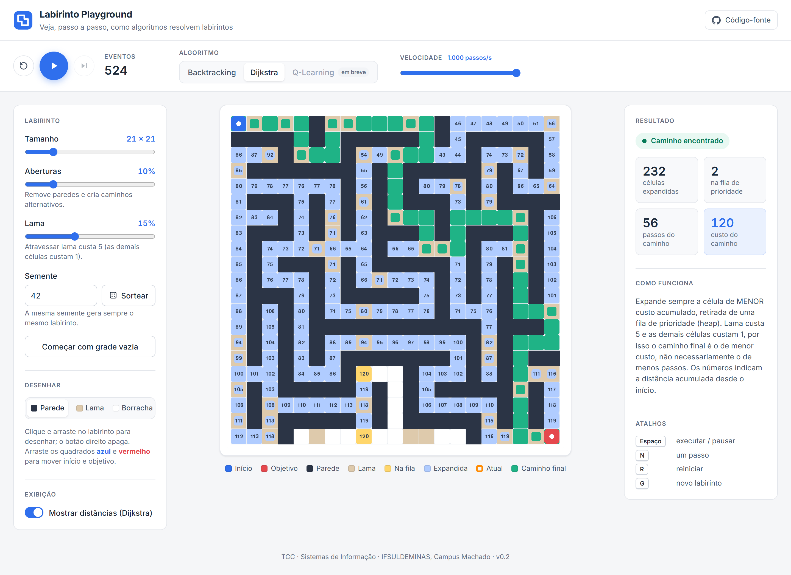

# Labirinto Playground

Plataforma educacional interativa para visualizar **Backtracking**, **Dijkstra** e **Q-Learning**
resolvendo labirintos, inspirada no [TensorFlow Playground](https://playground.tensorflow.org/).

TCC · Sistemas de Informação · IFSULDEMINAS, Campus Machado
Autores: Arielce José Pereira Junior e Rafael da Silva Rabelo · Orientador: Prof. Matheus Eloy Franco

**Versão atual:** v0.3: Backtracking, Dijkstra e **Q-Learning**, interface web (HTML/CSS) com o labirinto em Pygame.



### ▶ [Abrir no navegador](https://raffasrabelo.github.io/labirinto-playground/)
`https://raffasrabelo.github.io/labirinto-playground/` (leva alguns segundos para carregar; recomendado em computador)

## Como funciona

| Parte | Tecnologia | Pasta |
|---|---|---|
| Algoritmos, labirinto e estado da sessão | Python puro (testado com pytest) | `app/algorithms`, `app/core` |
| Desenho do labirinto e edição com o mouse | pygame-ce | `app/ui` |
| Controles, métricas, legenda e design | HTML, CSS e JavaScript | `web/src` |
| Execução no navegador | pygbag (WebAssembly) | `tools/build_web.py` |

Detalhes, diagramas e o formato das mensagens entre a página e o Python estão em
[docs/02-arquitetura.md](docs/02-arquitetura.md).

## Rodar localmente (versão web)

Requer Python 3.10+ e internet (o Python para navegador vem do CDN do pygbag).

```bash
pip install pygame-ce pygbag
```

Na pasta raiz do projeto:

```bash
python tools/build_web.py --serve
```

Abra <http://localhost:8000> e aguarde alguns segundos.
Para só gerar os arquivos de publicação (`app/build/web/`): `python tools/build_web.py`.

## Modo desktop (desenvolvimento)

Abre só o labirinto, sem a interface HTML. Serve para depurar a lógica rapidamente.

```bash
cd app
```

```bash
python main.py
```

Atalhos: `Espaço` executar/pausar · `N` passo · `R` reiniciar · `G` novo labirinto ·
`1` Backtracking · `2` Dijkstra · `3` Q-Learning. O status aparece na barra de título da janela.

## Testes

```bash
pip install pytest
```

```bash
python -m pytest -q app/tests
```

## Publicação automática (GitHub Pages)

A cada `push` na branch `main`, o GitHub Actions ([deploy.yml](.github/workflows/deploy.yml))
roda os testes, gera o build web e publica no GitHub Pages. Se um teste falhar, nada é publicado.

## Documentação

| Documento | Conteúdo |
|---|---|
| [01 · Visão e requisitos](docs/01-visao-e-requisitos.md) | Visão, stakeholders, RF/RNF |
| [02 · Arquitetura e fluxos](docs/02-arquitetura.md) | Decisões (ADR), camadas, ponte JS↔Python, sequência, estados, deploy |
| [03 · Processo de trabalho](docs/03-processo-de-trabalho.md) | Scrum adaptado, cerimônias, fluxo de feedback, DoD, Git, uso de IA |
| [04 · Cronograma](docs/04-cronograma.md) | Sprints S0–S5, Gantt, riscos, plano de corte |
| [05 · Backlog](docs/05-backlog.md) | Histórias de usuário por épico |
| [06 · Algoritmos](docs/06-algoritmos.md) | Fluxogramas, mapa conceitual e comparação com dados reais |
| [07 · Diagramas](docs/07-diagramas.md) | Índice dos 29 diagramas, tipos e sugestão de uso no TCC |
| [08 · Legendas das figuras](docs/08-legendas-das-figuras.md) | Legenda, fonte e frase de chamada (ABNT) de todas as capturas e diagramas |
| [09 · Roteiro de aula: Q-Learning](docs/09-roteiro-aula-qlearning.md) | Experimentos verificados para uso em sala e o que registrar para o TCC |
| [Sprints](docs/sprints/) | Planejamento, review, feedback e retrospectiva de cada sprint |
| [Prompts](docs/prompts/) | Registro e catálogo de prompts de IA |

Os diagramas usam **Mermaid**: aparecem renderizados no GitHub e no VS Code. Para exportar
como imagem para o Word, use <https://mermaid.live>.
