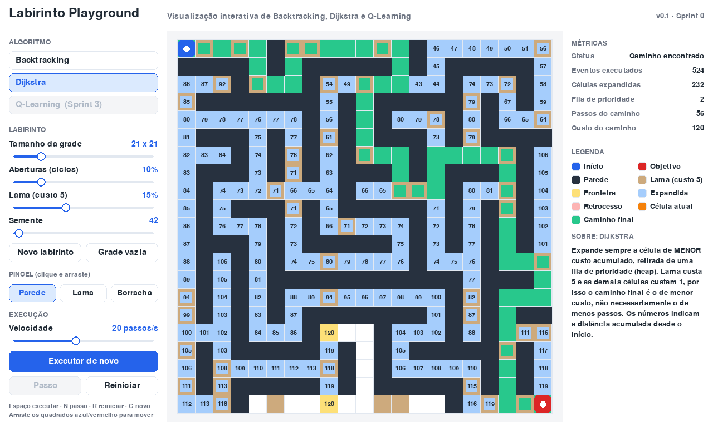

# Labirinto Playground

Plataforma educacional interativa para visualizar **Backtracking**, **Dijkstra** e **Q-Learning**
resolvendo labirintos, inspirada no [TensorFlow Playground](https://playground.tensorflow.org/).

TCC · Sistemas de Informação · IFSULDEMINAS, Campus Machado
Autores: Arielce José Pereira Junior e Rafael da Silva Rabelo · Orientador: Prof. Matheus Eloy Franco

**Versão atual:** v0.1 (Sprint 0): Dijkstra e Backtracking, no desktop e no navegador.



## Como executar (desktop)

Requer Python 3.10 ou superior.

```bash
pip install -r app/requirements.txt
```

```bash
cd app
```

```bash
python main.py
```

**Controles:** clique e arraste no labirinto para pintar (botão direito apaga); arraste os
quadrados azul (início) e vermelho (objetivo). Teclado: `Espaço` executar/pausar,
`N` um passo, `R` reiniciar, `G` novo labirinto.

## Testes

```bash
pip install pytest
```

```bash
python -m pytest -q app/tests
```

## Versão web (navegador, via WebAssembly)

Testada e funcionando desde a Sprint 0 (ver [P01](docs/prompts/P01-build-web.md)). Precisa de
internet, porque o Python e o pygame-ce para navegador são baixados do CDN do pygbag.

```bash
pip install pygbag
```

Para testar localmente (a partir da pasta raiz `TCC`):

```bash
python -m pygbag app
```

Depois, abra <http://localhost:8000> e aguarde alguns segundos de carregamento.
Em `localhost`, use sempre o servidor do pygbag; um servidor estático comum falha (erro 404 no pygame-ce).

Para gerar só os arquivos de publicação (GitHub Pages ou itch.io):

```bash
python -m pygbag --build --title "Labirinto Playground" app
```

O resultado fica em `app/build/web/` (`index.html`, `app.apk`, `favicon.png`).

## Documentação

| Documento | Conteúdo |
|---|---|
| [01 · Visão e requisitos](docs/01-visao-e-requisitos.md) | Visão, stakeholders, RF/RNF |
| [02 · Arquitetura e fluxos](docs/02-arquitetura.md) | Camadas, fluxo de uso, sequência, estados, Q-Learning previsto, deploy |
| [03 · Processo de trabalho](docs/03-processo-de-trabalho.md) | Scrum adaptado, cerimônias, fluxo de feedback, DoD, Git, uso de IA |
| [04 · Cronograma](docs/04-cronograma.md) | Sprints S0–S5, Gantt, riscos, plano de corte |
| [05 · Backlog](docs/05-backlog.md) | Histórias de usuário por épico |
| [Sprints](docs/sprints/) | Planejamento, review, feedback e retrospectiva de cada sprint |
| [Prompts](docs/prompts/) | Registro e catálogo de prompts de IA |

Os diagramas usam **Mermaid**: aparecem renderizados no GitHub e no VS Code. Para exportar
como imagem para o Word, use <https://mermaid.live>.
