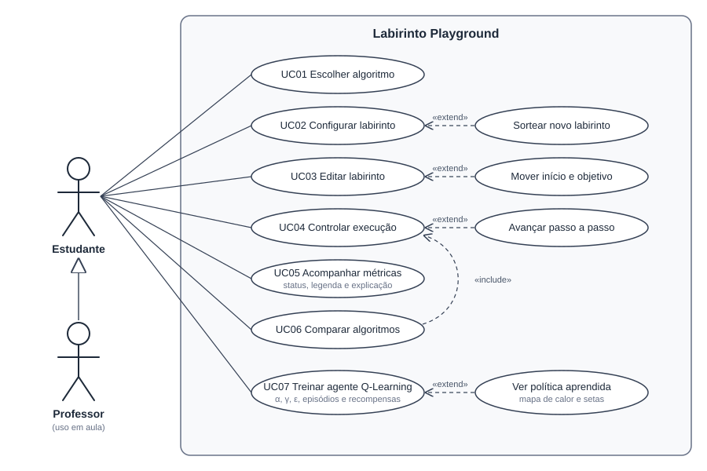
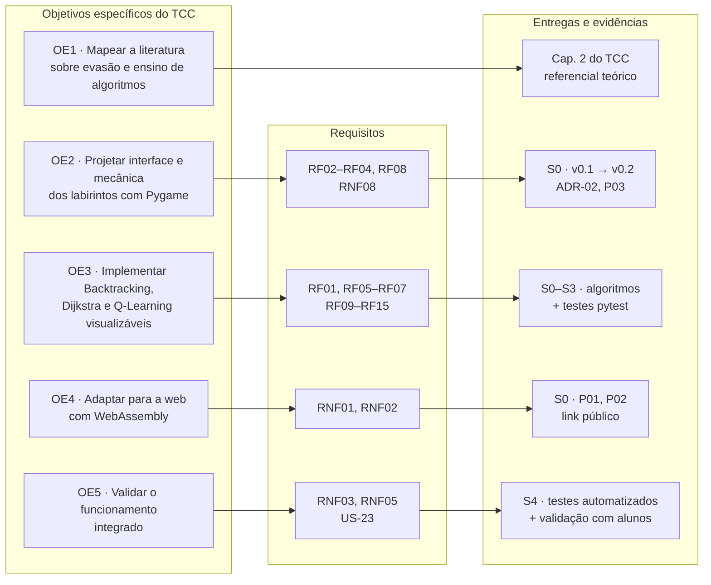

# 01 · Visão do Produto e Requisitos

## Visão

> Para **estudantes ingressantes em cursos de tecnologia** que têm dificuldade com a
> abstração de algoritmos, o **Labirinto Playground** é uma plataforma web interativa
> que mostra, passo a passo e de forma visual, como Backtracking, Dijkstra e Q-Learning
> resolvem labirintos. Diferente de executar código no terminal, o aluno **altera
> parâmetros e vê o efeito na hora**, como no
> [TensorFlow Playground](https://playground.tensorflow.org/).

**Questão de pesquisa (do TCC):** de que forma um ambiente virtual interativo, baseado na
resolução gráfica de labirintos, pode reduzir as dificuldades de abstração de ingressantes
no aprendizado de algoritmos de busca, otimização e IA?

## Princípios de design (inspirados no TensorFlow Playground)

1. **Uma tela só:** controles de execução no topo, parâmetros à esquerda, labirinto no centro, métricas e explicação à direita.
2. **Feedback imediato:** mudar um parâmetro regenera o cenário na hora.
3. **Controle do tempo:** executar, pausar, avançar um passo, mudar a velocidade.
4. **Reprodutível:** a semente define o labirinto, então dois alunos com a mesma semente veem a mesma coisa.
5. **Comparável:** mesmo labirinto e algoritmos diferentes permitem comparar métricas (custo, células expandidas).
6. **Sem instalação:** roda no navegador (WebAssembly).

## Stakeholders

| Stakeholder | Interesse | Como participa |
|---|---|---|
| Orientador (Prof. Matheus Eloy Franco) | Qualidade técnica e científica do trabalho | Sprint Review semanal; valida escopo e decisões técnicas |
| Professora da disciplina de TCC | Cumprimento do cronograma e das normas | Acompanha os incrementos e a escrita; valida prazos |
| Estudantes ingressantes (usuários finais) | Entender os algoritmos | Validação na Sprint 4 |
| Equipe (Arielce e Rafael) | Entregar o TCC no prazo | Desenvolvimento, documentação e escrita |

## Requisitos Funcionais

| ID | Requisito | Prioridade | Sprint | Status |
|---|---|---|---|---|
| RF01 | Selecionar o algoritmo (Backtracking, Dijkstra, Q-Learning) | Must | S0 | ✅ |
| RF02 | Gerar labirinto procedural reproduzível por semente | Must | S0 | ✅ |
| RF03 | Ajustar tamanho, aberturas (ciclos) e porcentagem de lama | Must | S0 | ✅ |
| RF04 | Editar o labirinto com o mouse (parede, lama, borracha) e mover início e objetivo | Must | S0 | ✅ |
| RF05 | Executar, pausar, avançar passo a passo e reiniciar | Must | S0 | ✅ |
| RF06 | Controlar a velocidade da animação | Must | S0 | ✅ |
| RF07 | Exibir métricas: células expandidas, custo, passos, estrutura de dados | Must | S0 | ✅ |
| RF08 | Exibir legenda e explicação do algoritmo | Must | S0 | ✅ |
| RF09 | Exibir pseudocódigo com a linha em execução destacada | Should | S1/S2 | ⏳ |
| RF10 | Exibir a distância acumulada nas células (Dijkstra) | Should | S0 | ✅ |
| RF11 | Visualizar a pilha de recursão (Backtracking) | Must | S2 | ⏳ |
| RF12 | Configurar a ordem de exploração dos vizinhos (Backtracking) | Could | S2 | ⏳ |
| RF13 | Treinar agente Q-Learning com α, γ, ε, episódios e recompensas configuráveis | Must | S3 | ✅ |
| RF14 | Visualizar a Q-table (mapa de calor/setas da política) e a curva de aprendizado | Must/Should | S3 | ✅ |
| RF15 | Assistir ao agente treinado percorrendo o labirinto | Must | S3 | ✅ |
| RF16 | Comparar dois algoritmos no mesmo labirinto | Could | S4 | ⏳ |
| RF17 | Tutorial/onboarding na primeira abertura | Could | S4 | ⏳ |

## Requisitos Não Funcionais

| ID | Requisito | Como verificar |
|---|---|---|
| RNF01 | Executar em navegadores modernos (Chrome, Edge, Firefox) sem instalação | Build pygbag publicado e testado nos 3 navegadores |
| RNF02 | Animação fluida (≥ 30 fps) em grades de até 41×41 no navegador | Medição de FPS na S1 |
| RNF03 | Lógica dos algoritmos desacoplada da interface e coberta por testes automatizados | `pytest` passando em toda sprint |
| RNF04 | Interface em português, com linguagem acessível ao ingressante | Revisão na Sprint Review + validação S4 |
| RNF05 | Reprodutibilidade: mesma semente e parâmetros geram o mesmo labirinto | Teste automatizado |
| RNF06 | Código versionado e aberto (Git/GitHub) | Repositório público com tags por sprint |
| RNF07 | Cores distinguíveis e com contraste adequado | Checagem com simulador de daltonismo na S4 |
| RNF08 | Interface com tipografia nítida e responsiva (computador e celular), sem rolagem horizontal | Teste em 1366 px e 375 px; labirinto renderizado na densidade real da tela (ADR-02) |

## Casos de uso

O Mermaid não tem diagrama de casos de uso da UML, por isso este foi desenhado em SVG (vetor:
pode ser inserido no Word sem perder qualidade).

| Caso de uso | Descrição | Requisitos |
|---|---|---|
| UC01 Escolher algoritmo | Seleciona Backtracking, Dijkstra ou Q-Learning | RF01 |
| UC02 Configurar labirinto | Ajusta tamanho, aberturas, lama e semente; pode sortear um novo (extensão) | RF02, RF03 |
| UC03 Editar labirinto | Desenha parede e lama, apaga, move início e objetivo (extensão) | RF04 |
| UC04 Controlar execução | Executa, pausa, reinicia, muda a velocidade; pode avançar passo a passo (extensão) | RF05, RF06 |
| UC05 Acompanhar métricas | Lê status, métricas, legenda, explicação e distâncias | RF07, RF08, RF10 |
| UC06 Comparar algoritmos | Executa dois algoritmos na mesma semente e compara métricas (inclui UC04) | RF16 |
| UC07 Treinar agente Q-Learning | Ajusta α, γ, ε, episódios e recompensas, treina e vê a política aprendida | RF13–RF15 |

O **Professor** herda todos os casos de uso do Estudante (generalização): usa a mesma
plataforma para demonstrar em aula.

## Rastreabilidade: objetivos do TCC → requisitos → entregas

Mostra que cada objetivo específico do TCC tem requisitos e entregas que o comprovam.

> **Atenção (OE2):** com a ADR-02, o Pygame passou a desenhar o labirinto e a interface foi
> para HTML/CSS. Confirmar com o orientador se o texto do OE2 precisa ser ajustado (pergunta 6
> da [Sprint Review 0](sprints/sprint-00.md)).
