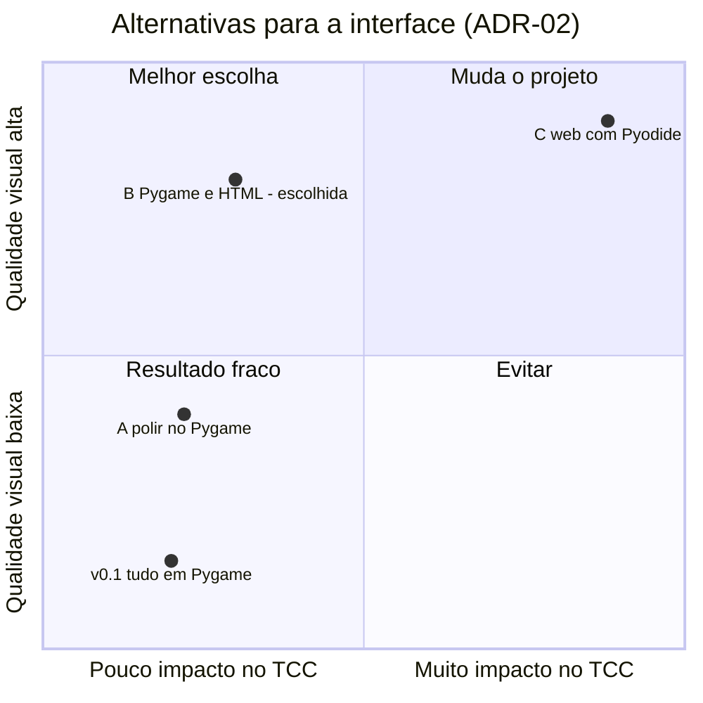
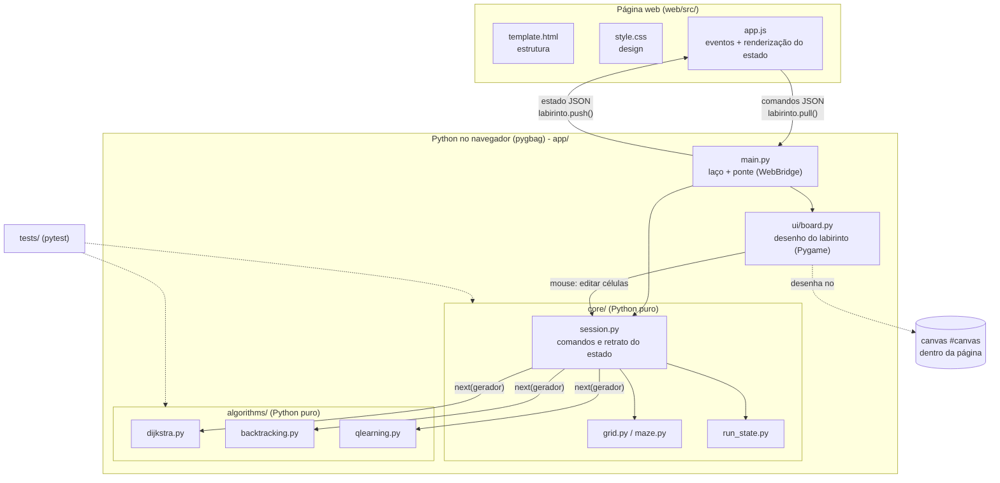
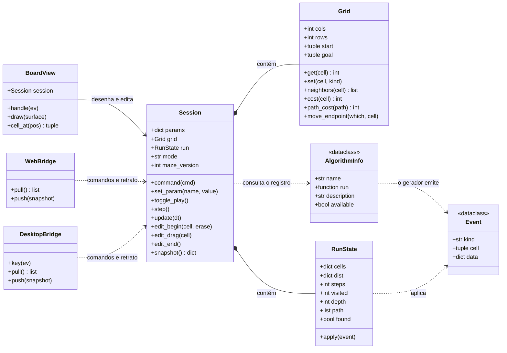
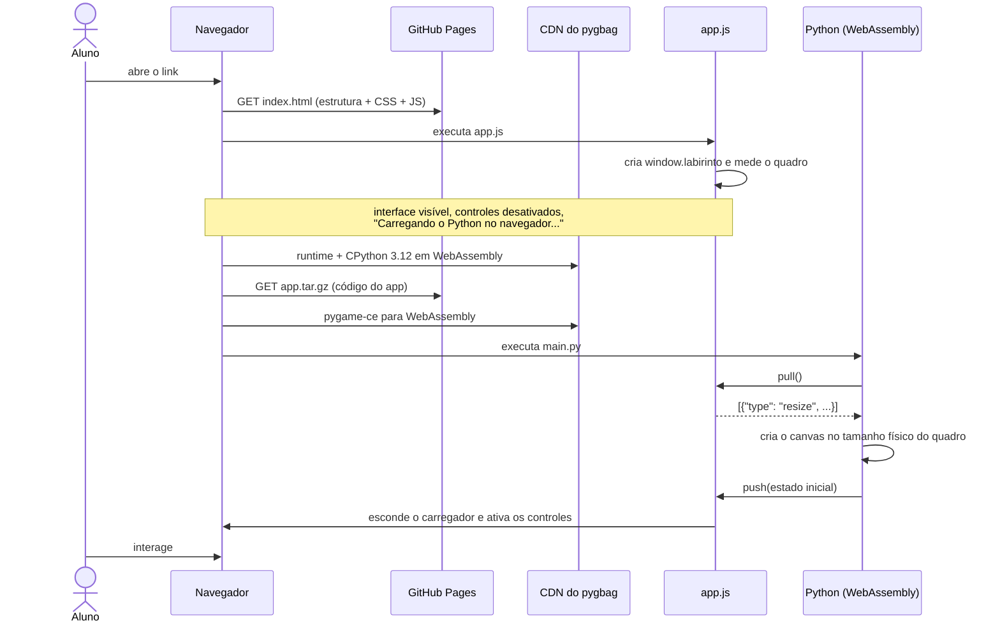
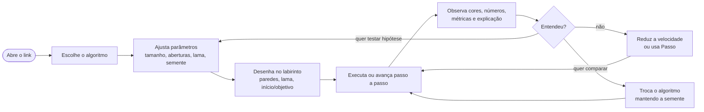
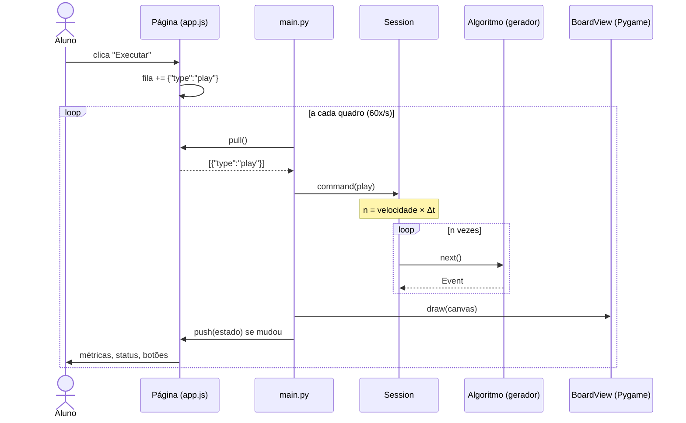
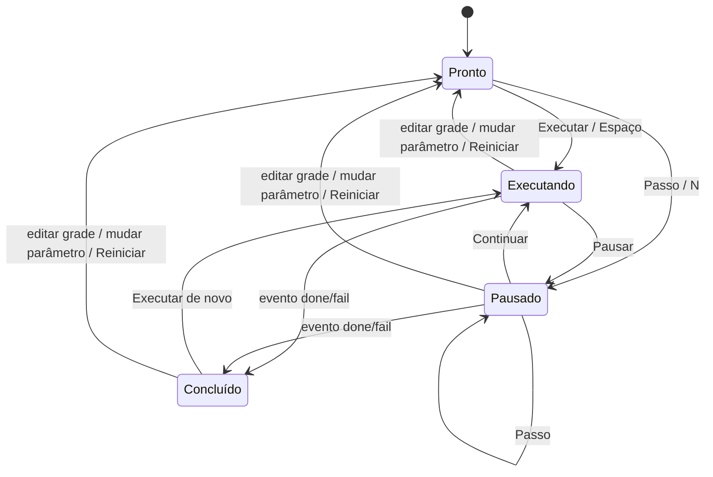
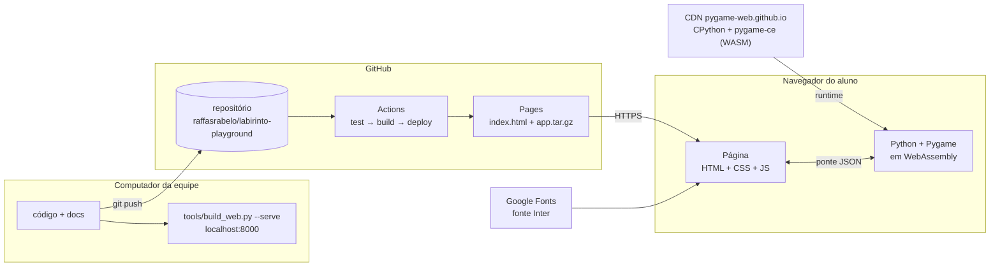
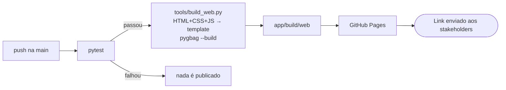

# 02 · Arquitetura e Fluxos da Plataforma

## Tecnologias

| Camada | Tecnologia | Por quê |
|---|---|---|
| Lógica (algoritmos, labirinto, sessão) | Python 3.12+ | Definida no TCC; sintaxe próxima do pseudocódigo das disciplinas |
| Visualização do labirinto | **pygame-ce** (Community Edition do Pygame) | Desenho e edição da grade; é a versão usada pelo pygbag |
| Interface (controles, métricas, legenda) | **HTML + CSS + JavaScript** | Componentes nativos do navegador, tipografia nítida, layout responsivo e acessível |
| Execução no navegador | **pygbag** (Python/Pygame → WebAssembly) | Roda o Python no navegador, sem instalação |
| Testes | pytest | Valida a lógica sem abrir janela nem navegador |
| Publicação | GitHub Actions + GitHub Pages | Link público atualizado a cada push |

## Decisões de arquitetura (ADR)

### ADR-01 · Algoritmos como geradores de eventos (Sprint 0)
Cada algoritmo é uma função geradora que, a cada `yield`, devolve um `Event`
(`frontier`, `visit`, `backtrack`, `path`, `done`, `fail`). O algoritmo **não sabe desenhar**
e a interface **não sabe resolver labirintos**. Com isso:
1. **Passo a passo de graça:** pausar é parar de chamar `next()`.
2. **Velocidade ajustável:** a interface consome N eventos por segundo.
3. **Testabilidade:** os testes executam o gerador até o fim e conferem o resultado.
4. **Extensibilidade:** um algoritmo novo é só mais um gerador registrado em `algorithms/__init__.py`.

### ADR-02 · Interface híbrida: Pygame só no labirinto, HTML/CSS no restante (Sprint 0, 27/10)
**Contexto.** A v0.1 desenhava toda a interface em Pygame. Os algoritmos funcionavam, mas o
visual ficou fraco:
- o Pygame não tem componentes de interface;
- a única fonte disponível no navegador é a FreeSansBold, toda em negrito;
- o pygbag esticava uma imagem fixa de 1280×760, deixando o texto borrado.

**Decisão.** O Pygame desenha **apenas o labirinto** (grade, estados das células e edição com
o mouse). Parâmetros, botões, métricas, legenda e textos passam para HTML/CSS/JavaScript. As
duas partes conversam por uma ponte de mensagens JSON.

**Alternativas avaliadas.**
- (A) Polir a interface dentro do Pygame: o teto de qualidade era limitado.
- (C) Interface 100% web com Pyodide: o Pygame sairia do projeto, alterando os objetivos do TCC.

As posições abaixo são estimativas qualitativas da equipe, não medições. Os rótulos estão
sem acento porque este tipo de gráfico do Mermaid não aceita caracteres acentuados.



**Consequências.**
- ✅ Interface com qualidade de site moderno, responsiva e acessível.
- ✅ O canvas é desenhado na resolução física da tela, então o labirinto fica nítido.
- ✅ O Pygame continua sendo a tecnologia de visualização (objetivo específico 2 mantido).
- ⚠️ A versão desktop vira apenas ferramenta de desenvolvimento: só o labirinto e atalhos de teclado.
- ⚠️ Mais uma linguagem no projeto (JavaScript). Optou-se por JavaScript puro, sem TypeScript,
  porque o código da página é pequeno (~200 linhas) e assim não é preciso Node.js nem etapa de
  compilação. TypeScript pode ser adotado se a interface crescer.

## Visão em camadas



## Estrutura de pastas

```
app/                       # tudo que é empacotado pelo pygbag
├── main.py                # laço assíncrono + ponte (web) ou teclado (desktop)
├── algorithms/            # geradores de eventos (Dijkstra, Backtracking...)
├── core/
│   ├── grid.py            # modelo do labirinto
│   ├── maze.py            # geração com semente
│   ├── run_state.py       # aplica eventos -> estado desenhável
│   └── session.py         # parâmetros, comandos, execução, retrato do estado
├── ui/
│   ├── board.py           # desenho do labirinto + edição com o mouse
│   └── theme.py           # cores do labirinto (espelham o CSS)
└── tests/                 # pytest: algoritmos e sessão
web/src/                   # interface da página
├── template.html          # estrutura + bloco exigido pelo pygbag
├── style.css              # design system (tokens de cor, tipografia, layout)
└── app.js                 # ponte JS + eventos dos controles
tools/build_web.py         # junta HTML+CSS+JS e chama o pygbag
```

## Modelo de classes (Python)

Os algoritmos são **funções geradoras**, não classes. Eles aparecem pelo registro
`AlgorithmInfo.run`. `generate_maze()` é uma função que devolve um `Grid` pronto.



## Ponte JavaScript ↔ Python

O Python, a cada quadro (60 vezes por segundo):
1. chama `window.labirinto.pull()`, que devolve a fila de comandos da página em JSON (ou `""`);
2. aplica os comandos na `Session`;
3. desenha o labirinto;
4. chama `window.labirinto.push(estadoJSON)`, **apenas se o estado mudou**.

**Comandos (página → Python)**

| Comando | Exemplo |
|---|---|
| Alterar parâmetro | `{"type": "set", "name": "size", "value": 31}`. Nomes: `algorithm`, `size`, `openness`, `mud`, `seed`, `speed`, `brush`, `show_numbers` |
| Executar / pausar | `{"type": "play"}` |
| Um passo | `{"type": "step"}` |
| Reiniciar | `{"type": "reset"}` |
| Novo labirinto (semente aleatória) | `{"type": "new_maze"}` |
| Grade vazia | `{"type": "clear"}` |
| Tamanho do quadro | `{"type": "resize", "w": 1292, "h": 1292}` (pixels físicos = CSS × devicePixelRatio) |

Todos os valores são validados no Python (`Session.set_param`): limites, tamanho ímpar,
algoritmo disponível. A página nunca é a fonte da verdade.

**Estado (Python → página)**

```json
{
  "mode": "running",
  "status": "running",
  "params": {"algorithm": "dijkstra", "size": 21, "openness": 10, "mud": 15,
             "seed": 42, "speed": 20, "brush": "wall", "show_numbers": true},
  "description": "Expande sempre a célula de MENOR custo acumulado...",
  "metrics": {"steps": 80, "visited": 39, "frontier": 2, "depth": 0,
              "max_depth": 0, "moves": null, "cost": null}
}
```
`status` pode ser `idle`, `running`, `paused`, `found` ou `no_path`.

## Carregamento da página

A interface aparece logo; os controles só são ativados quando o Python envia o primeiro estado.



## Fluxo de uso (jornada do aluno)



## Ciclo de execução



## Estados da execução



## Modelo do labirinto

- Grade de `N × N` células com N ímpar (11 a 61). Cada célula é **livre** (custo 1), **lama** (custo 5) ou **parede**.
- Geração: busca em profundidade randomizada → labirinto **perfeito** (um único caminho entre dois pontos).
- **Aberturas** removem paredes internas ao acaso → surgem ciclos → passa a existir caminho mais curto e mais longo. É isso que torna o Dijkstra interessante.
- **Lama** torna o custo diferente do número de passos → mostra a diferença entre "menor caminho" e "menor custo".
- **Semente** controla todas as escolhas aleatórias (geradores separados por parâmetro, então mudar a lama não altera o desenho do labirinto).

## Algoritmos: o que cada um emite

| Evento | Dijkstra | Backtracking | Q-Learning |
|---|---|---|---|
| `frontier` | célula entrou na fila de prioridade (com distância) | — | — |
| `visit` | célula retirada da fila (expandida) | chamada recursiva (empilha) | — |
| `backtrack` | — | retorno da recursão (desempilha) | — |
| `agent` | — | — | o agente deu um passo (o 1º de cada episódio leva a tabela Q, o nº do episódio e o ε) |
| `episode` | — | — | fim de um episódio: recompensa total, passos, se chegou ao objetivo, ε |
| `path` | caminho ótimo reconstruído | pilha final = caminho | percurso seguindo a política aprendida (sempre a ação de maior Q) |
| `done`/`fail` | custo e passos | custo e passos | custo e passos da política; `fail` se ela não chega ao objetivo |

## Q-Learning (implementado na v0.3, 11/11)

- **Estado:** célula `(x, y)`. **Ações:** cima, direita, baixo, esquerda.
- **Recompensas:** entrar numa célula custa o mesmo que nos outros algoritmos (livre −1,
  lama −5); bater na parede vale −penalidade (padrão 10) e o agente fica no lugar; chegar ao
  objetivo vale +recompensa (padrão 100) e encerra o episódio.
- **Atualização:** `Q(s,a) ← Q(s,a) + α · [r + γ · maxₐ' Q(s',a') − Q(s,a)]`; no objetivo, o alvo é só `r`.
- **Exploração:** ε-greedy; ε é multiplicado pelo decaimento a cada episódio (mínimo 0,01).
- **Limite de passos por episódio:** `max(200, 4 × células livres)`.
- **Valores padrão** (α 0,5; γ 0,995; ε 0,3; decaimento 0,99; 200 episódios): escolhidos por
  experimento, ver [06-algoritmos.md](06-algoritmos.md#q-learning-escolha-dos-valores-padrão).
- **Reprodutível:** o gerador aleatório do agente usa a semente do labirinto.
- **Visualização no Pygame:** mapa de calor violeta com o valor `max Q` de cada célula
  (normalizado entre o menor e o maior valor), seta com a melhor ação e o agente como um
  círculo laranja. **Na página:** parâmetros, métricas do treino e gráfico SVG da recompensa
  por episódio (série reduzida a no máximo 200 pontos, com média móvel).
- **Desempenho:** a sessão processa eventos até ~12 ms por quadro e descarta o atraso
  acumulado, então a página continua fluida a 100.000 passos/s. Medido no navegador: o treino
  completo do labirinto 21 × 21 da demo (48.761 eventos) termina em menos de 1 segundo na
  velocidade máxima.

Novos parâmetros aceitos por `{"type": "set"}`: `alpha`, `gamma`, `epsilon`, `decay`,
`episodes`, `goal_reward`, `wall_penalty`, `show_policy`. Novos campos do estado:
`metrics.episode`, `metrics.episodes`, `metrics.epsilon`, `metrics.episode_steps`,
`metrics.last_reward`, `metrics.reached` e a lista `rewards`.

## Implantação: onde cada parte roda



Tudo roda no navegador do aluno: não há servidor de aplicação nem banco de dados. O GitHub
Pages só entrega arquivos estáticos.

## Fluxo de build e publicação


