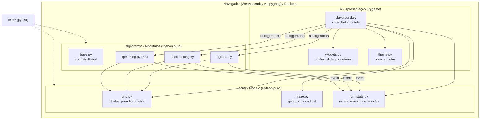
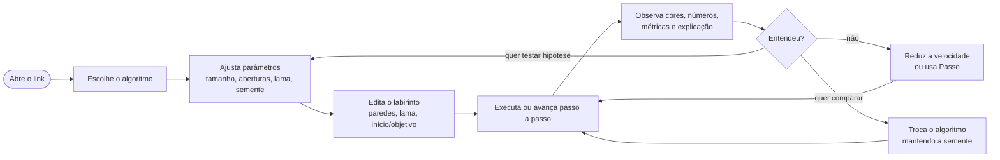
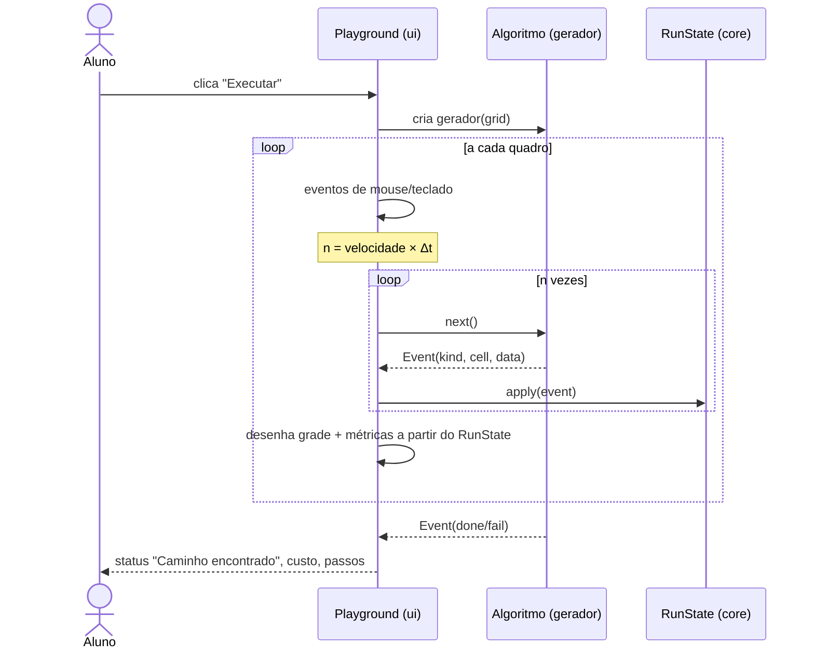
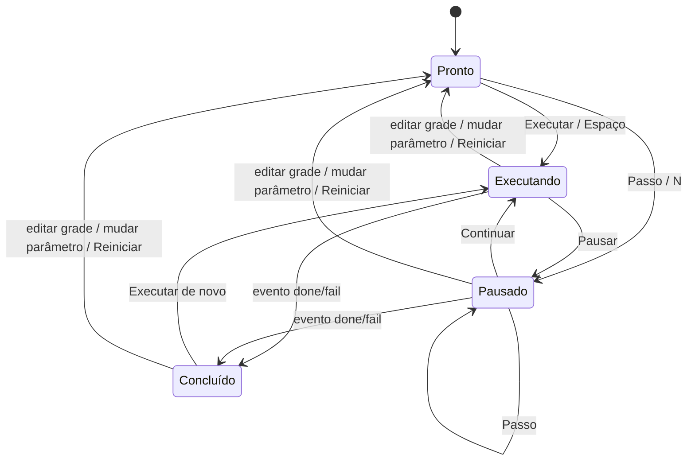
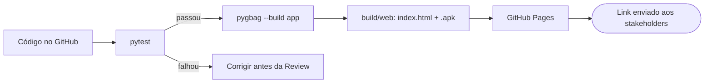

# 02 · Arquitetura e Fluxos da Plataforma

## Tecnologias

| Camada | Tecnologia | Por quê |
|---|---|---|
| Linguagem | Python 3.12+ | Definida no TCC; sintaxe próxima do pseudocódigo das disciplinas |
| Gráficos e interação | **pygame-ce** (Community Edition do Pygame) | É a versão que o pygbag usa no navegador; API compatível com o Pygame |
| Web | **pygbag** (Pygame → WebAssembly) | Roda o mesmo código Python no navegador, sem instalação |
| Testes | pytest | Valida a lógica dos algoritmos sem abrir janela |
| Hospedagem | GitHub Pages (ou itch.io) | Gratuita e com link público para os stakeholders |
| Versionamento | Git + GitHub | Histórico por sprint (tags `sprint-N`) |

## Decisão central: algoritmos como **geradores de eventos**

Cada algoritmo é uma função geradora Python que, a cada `yield`, devolve um `Event`
(`frontier`, `visit`, `backtrack`, `path`, `done`, `fail`). O algoritmo **não sabe
desenhar**; a interface **não sabe resolver labirintos**.

Isso traz quatro ganhos, todos citáveis no TCC:
1. **Passo a passo de graça:** pausar é parar de chamar `next()`.
2. **Velocidade ajustável:** a interface consome N eventos por segundo.
3. **Testabilidade:** os testes executam o gerador até o fim e conferem o resultado (RNF03).
4. **Extensibilidade:** um algoritmo novo é só mais um gerador registrado em `algorithms/__init__.py`.

## Visão em camadas



## Estrutura de pastas

```
app/
├── main.py              # ponto de entrada (laço assíncrono exigido pelo pygbag)
├── algorithms/
│   ├── __init__.py      # registro: nome, função, descrição, disponível?
│   ├── base.py          # Event + tipos de evento
│   ├── dijkstra.py
│   └── backtracking.py
├── core/
│   ├── grid.py          # modelo do labirinto
│   ├── maze.py          # geração com semente
│   └── run_state.py     # aplica eventos -> estado desenhável
├── ui/
│   ├── playground.py    # layout, eventos de mouse/teclado, desenho
│   ├── widgets.py
│   └── theme.py
└── tests/
    └── test_algorithms.py
```

## Fluxo de uso (jornada do aluno)



## Ciclo de execução (a cada quadro, 60×/s)



## Estados da execução



## Modelo do labirinto

- Grade de `N × N` células com N ímpar (11 a 61). Cada célula é **livre** (custo 1), **lama** (custo 5) ou **parede**.
- Geração: busca em profundidade randomizada → labirinto **perfeito** (um único caminho entre dois pontos).
- **Aberturas** removem paredes internas ao acaso → surgem ciclos → passa a existir caminho mais curto e mais longo. É isso que torna o Dijkstra interessante.
- **Lama** torna o custo diferente do número de passos → mostra a diferença entre "menor caminho" e "menor custo".
- **Semente** controla todas as escolhas aleatórias (geradores separados por parâmetro, então mudar a lama não altera o desenho do labirinto).

## Algoritmos: o que cada um emite

| Evento | Dijkstra | Backtracking | Q-Learning (S3, previsto) |
|---|---|---|---|
| `frontier` | célula entrou na fila de prioridade (com distância) | — | — |
| `visit` | célula retirada da fila (expandida) | chamada recursiva (empilha) | agente se move |
| `backtrack` | — | retorno da recursão (desempilha) | — |
| `path` | caminho ótimo reconstruído | pilha final = caminho | política aprendida (gulosa) |
| `done`/`fail` | custo e passos | custo e passos | recompensa média, episódios |

## Desenho previsto do Q-Learning (Sprint 3)

- **Estado:** célula `(x, y)`. **Ações:** cima, direita, baixo, esquerda.
- **Recompensas (configuráveis):** objetivo +100; passo −1; lama −5; bater na parede −10 (fica no lugar).
- **Atualização:** `Q(s,a) ← Q(s,a) + α · [r + γ · maxₐ' Q(s',a') − Q(s,a)]`
- **Exploração:** ε-greedy com decaimento por episódio.
- **Parâmetros na interface:** α, γ, ε inicial, decaimento de ε, nº de episódios, máximo de passos por episódio.
- **Visualização:** cor de cada célula = `max Q` (mapa de calor), seta = melhor ação, gráfico de recompensa por episódio, botão "assistir agente".
- O treino também é um gerador: emite um evento por passo do agente ou por episódio (configurável), para manter a interface responsiva no navegador.

## Fluxo de build e publicação (a partir da S1)


