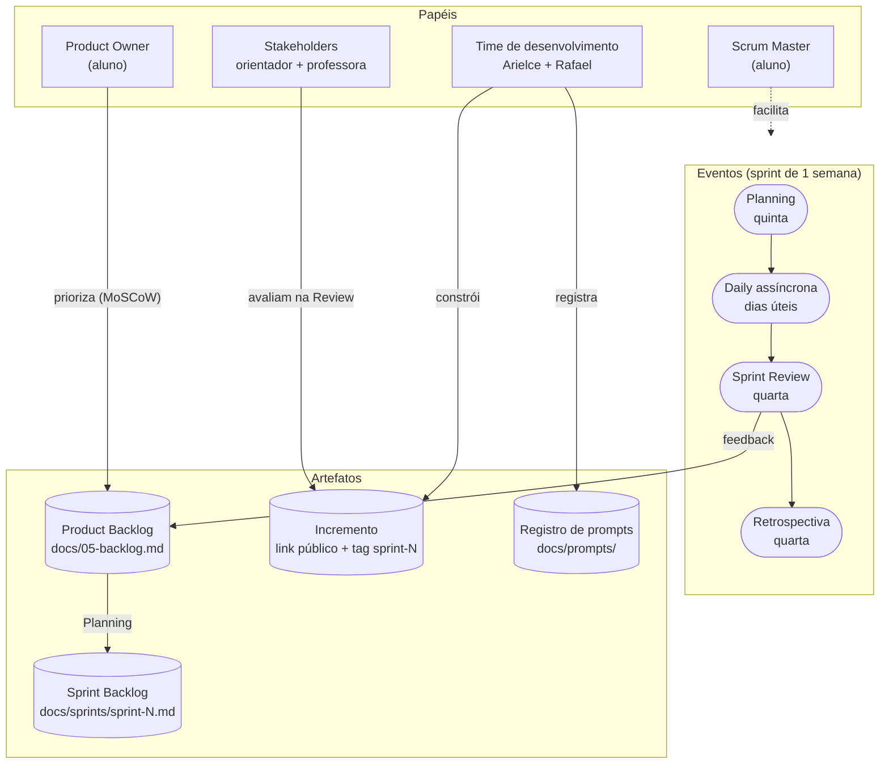
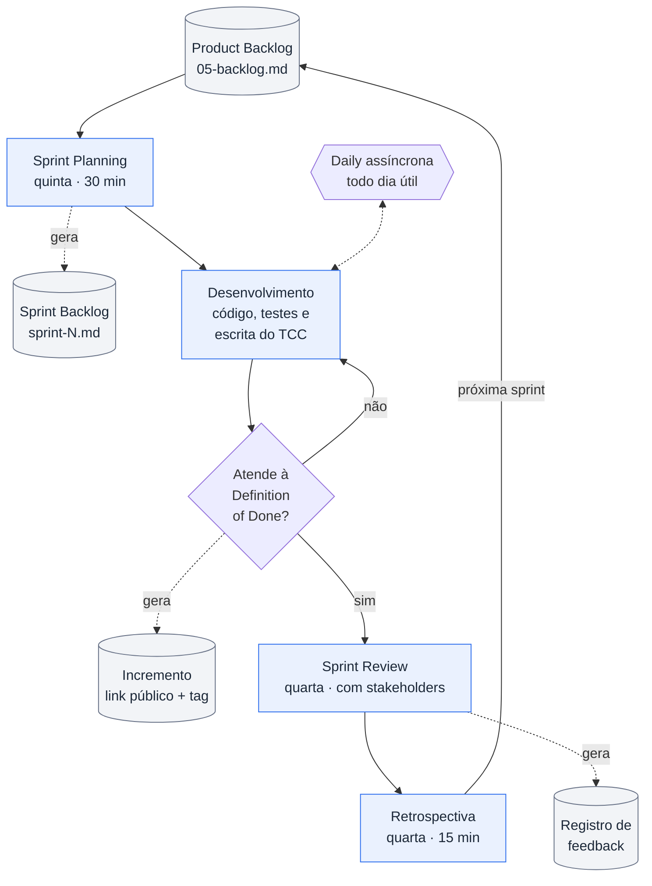
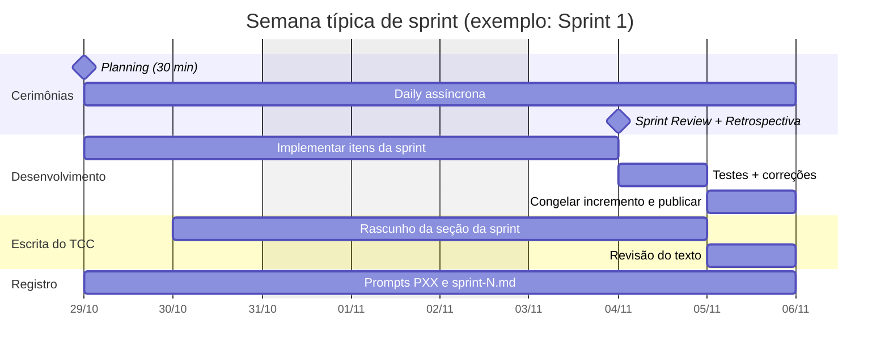
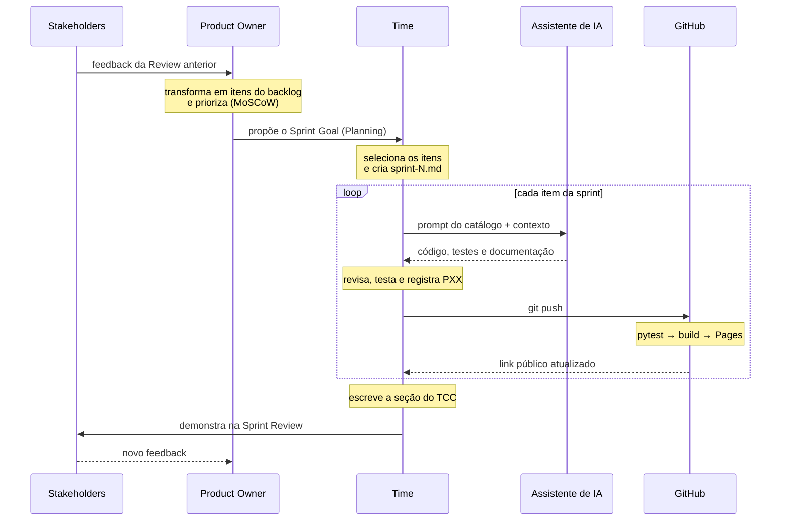
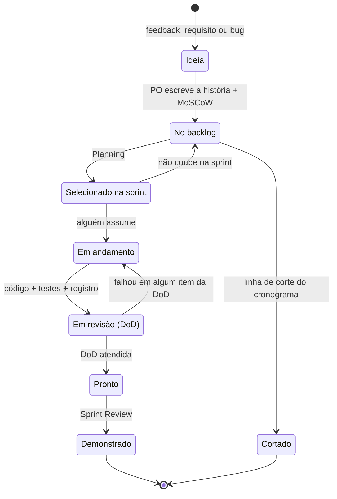
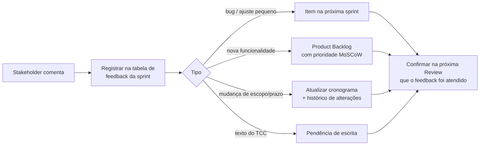
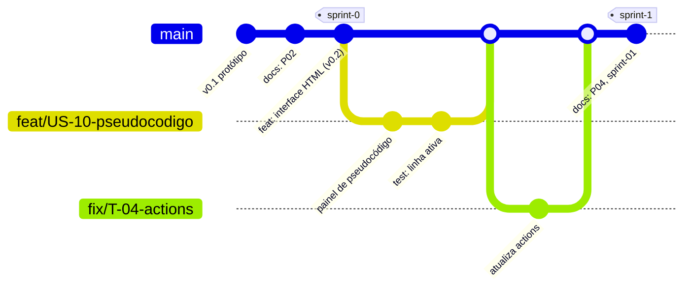
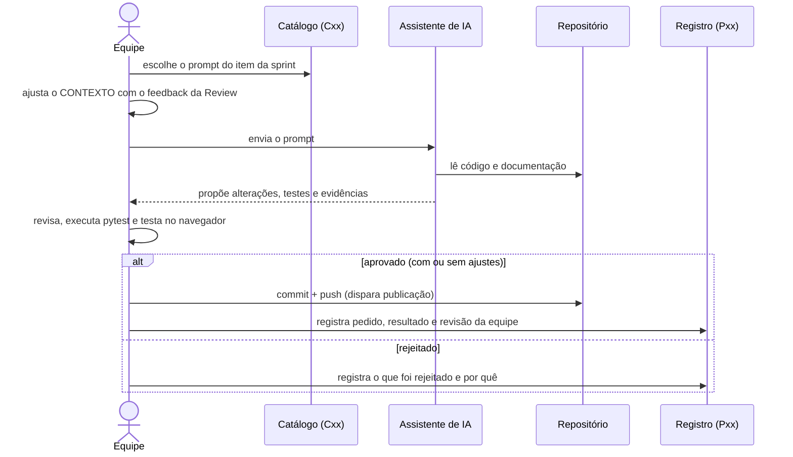

# 03 · Processo de Trabalho (Scrum adaptado)

O TCC (cap. 3.1) já define o uso de **Scrum**. Este documento descreve como ele
é aplicado a uma equipe de duas pessoas com dois stakeholders acadêmicos.

| Diagrama | Tipo | Pergunta que responde |
|---|---|---|
| [Visão geral do Scrum](#visão-geral-do-scrum-no-projeto) | fluxograma em blocos | Quais são os papéis, eventos e artefatos? |
| [Ciclo da sprint](#ciclo-da-sprint-1-semana-quinta--quarta) | fluxograma | Em que ordem as coisas acontecem? |
| [Semana típica](#semana-típica-de-sprint) | Gantt | Em que dia acontece cada atividade? |
| [Quem faz o quê](#quem-faz-o-quê) | sequência (colunas = raias) | Qual papel executa cada passo? |
| [Ciclo de vida de um item](#ciclo-de-vida-de-um-item-do-backlog) | diagrama de estados | Por quais estados uma tarefa passa? |
| [Fluxo do feedback](#fluxo-do-feedback) | fluxograma de decisão | O que acontece com cada comentário dos stakeholders? |
| [Fluxo de código](#fluxo-de-código-git) | gitGraph | Como o código chega à `main` e vira versão? |
| [Uso de IA](#uso-de-ia-generativa-no-projeto) | diagrama de sequência | Como um prompt vira código e registro? |

## Papéis

| Papel Scrum | Quem | Responsabilidade |
|---|---|---|
| Stakeholder principal / "cliente" | Orientador | Valida o incremento e prioriza junto com a equipe |
| Stakeholder | Professora da disciplina de TCC | Acompanha prazos, normas e escrita |
| Product Owner | *(definir: um dos alunos)* | Mantém o backlog e traduz o feedback em itens |
| Scrum Master | *(definir: o outro aluno, ou revezamento)* | Garante as cerimônias e os registros |
| Time de desenvolvimento | Arielce e Rafael | Código, testes, documentação e escrita |

> Como a equipe é pequena, os papéis de PO e SM são acumulados. Escrever isso no TCC
> como adaptação consciente do Scrum é melhor do que fingir uma equipe completa.

## Visão geral do Scrum no projeto

Os três pilares do Scrum (papéis, eventos e artefatos) e onde cada artefato fica no repositório.

## Ciclo da sprint (1 semana: quinta → quarta)

Desenhado em **retrato** para caber na largura da página do TCC (proporção altura/largura de
cerca de 1,4, perto da área útil de uma folha A4). Como ler:
- a **espinha central** são os eventos da sprint, de cima para baixo;
- ao lado de cada evento fica o **artefato** que ele gera (linha pontilhada);
- tudo entre a *Sprint Planning* e a *Retrospectiva* acontece dentro da sprint de 1 semana;
- a seta da direita fecha o ciclo e volta ao *Product Backlog* para a próxima sprint.

Retângulos azuis são **eventos**; cilindros cinza são **artefatos**.

### Cerimônias

| Cerimônia | Quando | Duração | Saída registrada |
|---|---|---|---|
| **Planning** | Quinta | 30 min | Sprint Goal + itens escolhidos em `sprint-N.md` |
| **Daily** (assíncrona) | Todo dia útil | 2 min | Mensagem no grupo: *fiz / vou fazer / impedimento* |
| **Sprint Review** | Quarta | 15–20 min | Demo + feedback na tabela da sprint |
| **Retrospectiva** | Quarta, após a review | 15 min | *manter / melhorar / experimentar* |

### Roteiro padrão da Sprint Review (≈15 min)
1. Sprint Goal e o que foi concluído (1 min).
2. **Demonstração ao vivo** do incremento (5–7 min).
3. O que não foi concluído e por quê (1 min).
4. Plano da próxima sprint (2 min).
5. **Perguntas direcionadas** aos stakeholders (5 min). Sempre levar 3 a 5 perguntas prontas: o feedback fica muito melhor do que só perguntar "o que acharam?".

## Semana típica de sprint

Exemplo com as datas da Sprint 1. Fins de semana e o feriado de Finados (02/11) aparecem como
intervalos sem trabalho.

## Quem faz o quê

Cada coluna funciona como uma **raia** (um participante). As setas são as passagens de bastão
e as notas são o que cada um faz na sua vez.

## Ciclo de vida de um item do backlog

## Fluxo do feedback

## Definition of Done (DoD)

Um item só está **pronto** quando:
- [ ] o código está no repositório (branch `main`) e os testes (`pytest`) passam;
- [ ] funciona na versão web (a partir da S1);
- [ ] foi demonstrado ou é demonstrável na Review;
- [ ] os prompts de IA usados estão registrados em `docs/prompts/`;
- [ ] a documentação afetada (requisitos, arquitetura, backlog) foi atualizada;
- [ ] **a parte correspondente do texto do TCC foi escrita** (mesmo que em rascunho).

## Fluxo de código (Git)

- `main` sempre funcionando; trabalho em branches `feat/US-xx-descricao`.
- Commits no padrão *Conventional Commits*: `feat:`, `fix:`, `docs:`, `test:`, `refactor:`.
- Ao fim de cada sprint: tag `sprint-N` (ex.: `sprint-0`). Cada tag é um incremento citável no TCC.
- Todo push na `main` dispara testes e publicação (ver [02-arquitetura.md](02-arquitetura.md#fluxo-de-build-e-publicação)).
- O repositório está hoje na pasta do OneDrive. Se a sincronização causar problemas na pasta
  `.git`, clone o repositório em uma pasta fora do OneDrive e trabalhe a partir dela.

Fluxo **previsto** a partir da Sprint 1 (na Sprint 0 os commits foram direto na `main`):

## Uso de IA generativa no projeto

O desenvolvimento usa um assistente de IA (Claude Code) como **par de programação**. Para
transparência acadêmica:
- todo prompt relevante é registrado em `docs/prompts/` (o que foi pedido, o que foi
  gerado, o que a equipe revisou ou alterou);
- toda saída é revisada, testada e assumida pela equipe;
- o TCC deve declarar esse uso na Metodologia (sugestão de texto em `docs/prompts/README.md`).
  **Confirme com o orientador as regras da instituição.**

