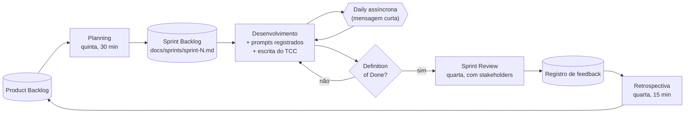
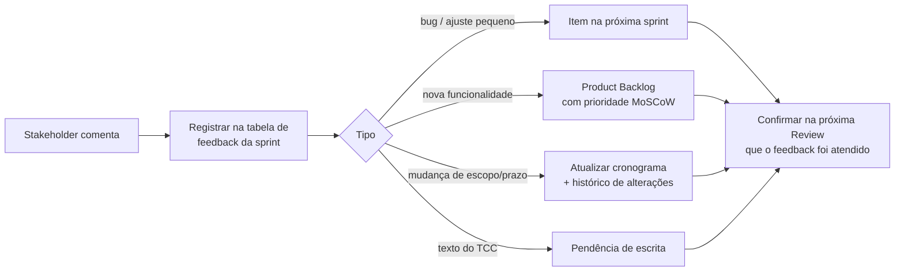

# 03 · Processo de Trabalho (Scrum adaptado)

O TCC (cap. 3.1) já define o uso de **Scrum**. Este documento descreve como ele
é aplicado a uma equipe de duas pessoas com dois stakeholders acadêmicos.

## Papéis

| Papel Scrum | Quem | Responsabilidade |
|---|---|---|
| Stakeholder principal / "cliente" | Orientador | Valida o incremento e prioriza junto com a equipe |
| Stakeholder | Professora da disciplina de TCC | Acompanha prazos, normas e escrita |
| Product Owner | *(definir: um dos alunos)* | Mantém o backlog e traduz o feedback em itens |
| Scrum Master | *(definir: o outro aluno, ou revezamento)* | Garante as cerimônias e os registros |
| Time de desenvolvimento | Arielce e Rafael | Código, testes, documentação e escrita |

> Como a equipe é pequena, os papéis de PO e SM são acumulados. Escrever isso no TCC
> como adaptação consciente do Scrum é melhor do que fingir uma equipe completa.

## Ciclo da sprint (1 semana: quinta → quarta)

### Cerimônias

| Cerimônia | Quando | Duração | Saída registrada |
|---|---|---|---|
| **Planning** | Quinta | 30 min | Sprint Goal + itens escolhidos em `sprint-N.md` |
| **Daily** (assíncrona) | Todo dia útil | 2 min | Mensagem no grupo: *fiz / vou fazer / impedimento* |
| **Sprint Review** | Quarta | 15–20 min | Demo + feedback na tabela da sprint |
| **Retrospectiva** | Quarta, após a review | 15 min | *manter / melhorar / experimentar* |

### Roteiro padrão da Sprint Review (≈15 min)
1. Sprint Goal e o que foi concluído (1 min).
2. **Demonstração ao vivo** do incremento (5–7 min).
3. O que não foi concluído e por quê (1 min).
4. Plano da próxima sprint (2 min).
5. **Perguntas direcionadas** aos stakeholders (5 min). Sempre levar 3 a 5 perguntas prontas: o feedback fica muito melhor do que só perguntar "o que acharam?".

## Fluxo do feedback

## Definition of Done (DoD)

Um item só está **pronto** quando:
- [ ] o código está no repositório (branch `main`) e os testes (`pytest`) passam;
- [ ] funciona na versão web (a partir da S1);
- [ ] foi demonstrado ou é demonstrável na Review;
- [ ] os prompts de IA usados estão registrados em `docs/prompts/`;
- [ ] a documentação afetada (requisitos, arquitetura, backlog) foi atualizada;
- [ ] **a parte correspondente do texto do TCC foi escrita** (mesmo que em rascunho).

## Fluxo de código (Git)

- `main` sempre funcionando; trabalho em branches `feat/US-xx-descricao`.
- Commits no padrão *Conventional Commits*: `feat:`, `fix:`, `docs:`, `test:`, `refactor:`.
- Ao fim de cada sprint: tag `sprint-N` (ex.: `sprint-0`). Cada tag é um incremento citável no TCC.
- **Recomendação:** manter o repositório Git **fora da pasta do OneDrive** (a sincronização
  pode corromper a pasta `.git`). O OneDrive fica com os .docx; o código vai para o GitHub.

## Uso de IA generativa no projeto

O desenvolvimento usa um assistente de IA (Claude Code) como **par de programação**. Para
transparência acadêmica:
- todo prompt relevante é registrado em `docs/prompts/` (o que foi pedido, o que foi
  gerado, o que a equipe revisou ou alterou);
- toda saída é revisada, testada e assumida pela equipe;
- o TCC deve declarar esse uso na Metodologia (sugestão de texto em `docs/prompts/README.md`).
  **Confirme com o orientador as regras da instituição.**
