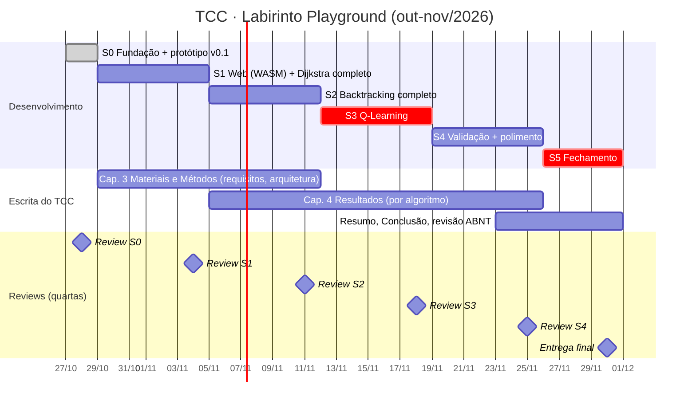

# 04 · Cronograma de Sprints

> Período: **27/10/2026 → 30/11/2026** · Sprints de 1 semana (quinta → quarta).
> A **Sprint Review acontece toda quarta-feira** com os stakeholders (orientador e
> professora da disciplina); o feedback entra no planejamento da quinta seguinte.
> As datas podem ser ajustadas, mas mudanças ficam registradas na tabela de histórico no fim deste arquivo.

## Visão geral

## Sprints

| Sprint | Período | Objetivo (Sprint Goal) | Incremento demonstrável | Escrita do TCC |
|---|---|---|---|---|
| **S0** | 27/10 – 28/10 | Fundação do projeto e protótipo navegável | v0.1: playground desktop com Dijkstra e Backtracking, labirinto procedural, edição com mouse, métricas | Estrutura da documentação; ajustes pendentes no .docx |
| **S1** | 29/10 – 04/11 | **Rodar no navegador** e completar o Dijkstra | v0.2: link público (pygbag + GitHub Pages); pseudocódigo com linha destacada; fila de prioridade visível | Cap. 3: requisitos (RF/RNF), arquitetura, diagramas |
| **S2** | 05/11 – 11/11 | Backtracking como ferramenta de ensino de **recursão** | v0.3: painel da pilha de chamadas, ordem de vizinhos configurável, modo exaustivo em grades pequenas | Cap. 4: seções Dijkstra e Backtracking |
| **S3** | 12/11 – 18/11 | **Q-Learning** treinável e visualizável | v0.4: parâmetros α, γ, ε, episódios e recompensas; mapa de calor da Q-table, setas da política, curva de recompensa | Cap. 4: seção Q-Learning; fundamentação de RL no Cap. 2 |
| **S4** | 19/11 – 25/11 | Validar com usuários e polir | v0.9: tutorial inicial, correções, testes com alunos (questionário) | Cap. 4: resultados da validação e discussão |
| **S5** | 26/11 – 30/11 | Fechamento | **v1.0** congelada + vídeo de demonstração + slides | Resumo/Abstract, Conclusão, revisão final |

### Atenção a feriados
- **02/11 (seg)** – Finados → S1 tem um dia útil a menos.
- **20/11 (sex)** – Dia da Consciência Negra (feriado nacional) → S4 tem um dia útil a menos.
- 15/11 cai em um domingo.

## Riscos e plano de corte

| # | Risco | Prob. | Impacto | Mitigação |
|---|---|---|---|---|
| R1 | Pygame não rodar bem no navegador (pygbag) | ~~Média~~ **Baixa** | Alto | ✅ **Mitigado em 27/10** (P01): o build roda e mantém 60 fps em 61×61. Resta publicar o link |
| R2 | Q-Learning atrasar (é o algoritmo mais complexo) | Alta | Alto | A lógica é pura e testável; a visualização mínima é o mapa de calor. Setas e gráfico ficam como "Should" |
| R3 | Desempenho ruim em grades 61×61 no navegador | Média | Médio | Limitar o tamanho na versão web e redesenhar apenas as células alteradas |
| R4 | Validação com usuários exigir aprovação de ética (CEP) | Média | Médio | Confirmar com o orientador na **Review S0**; alternativa: avaliação por especialistas (docentes) ou questionário anônimo de opinião |
| R5 | A escrita ficar para o final | Alta | Alto | Cada sprint tem uma meta de escrita e só termina com o texto escrito (ver Definition of Done) |

**Linha de corte (se precisar cortar escopo, nesta ordem):** modo comparação lado a lado →
modo exaustivo do Backtracking → gráfico de recompensa do Q-Learning → tutorial interativo.
**Não se corta:** os 3 algoritmos funcionando no navegador, as métricas e os controles de execução.

## Histórico de alterações do cronograma

| Data | Alteração | Motivo / quem pediu |
|---|---|---|
| 27/10/2026 | Versão inicial | Planejamento da Sprint 0 |
| 27/10/2026 | Build web (US-06/US-08) adiantado da S1 para a S0 | Equipe, para mostrar na Review de 28/10; a S1 ganha folga para o pseudocódigo |
