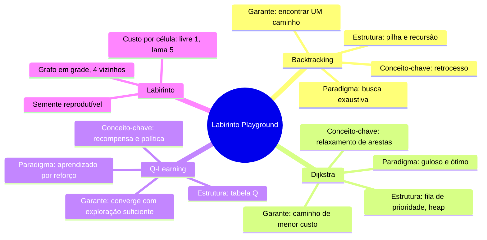
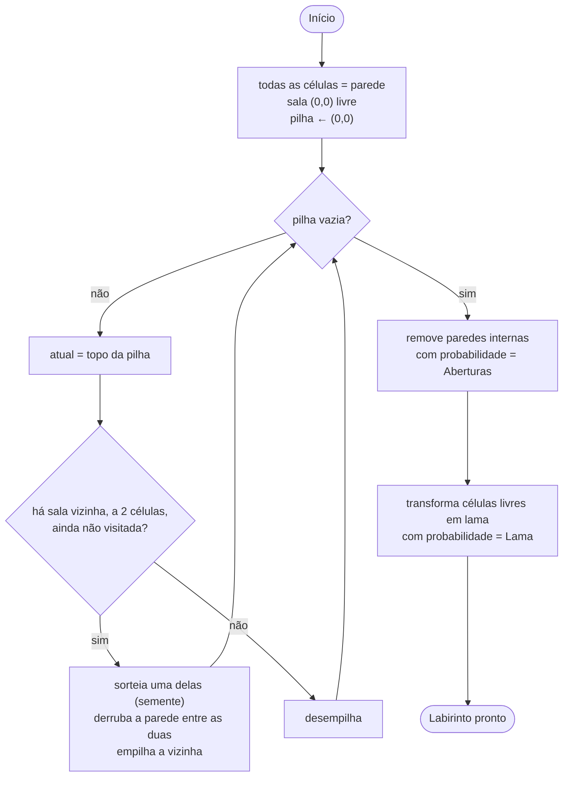
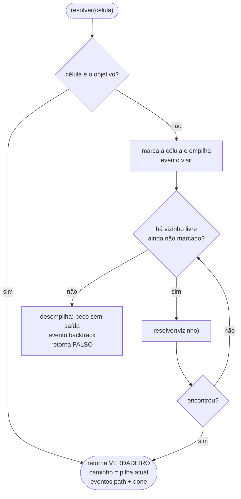
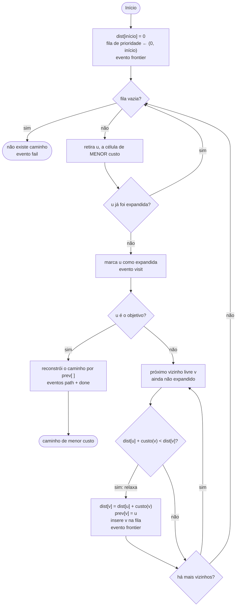
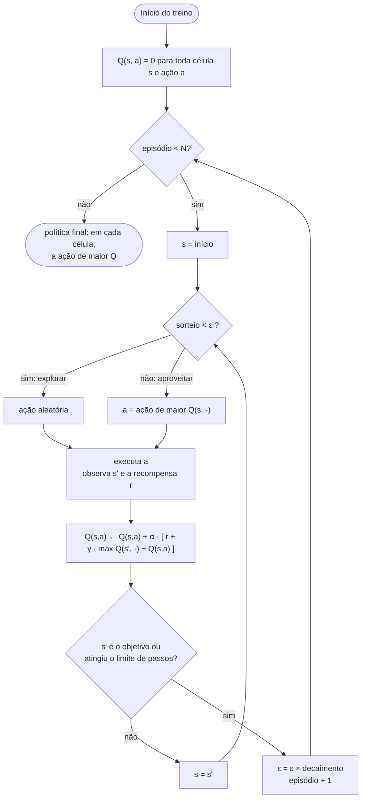
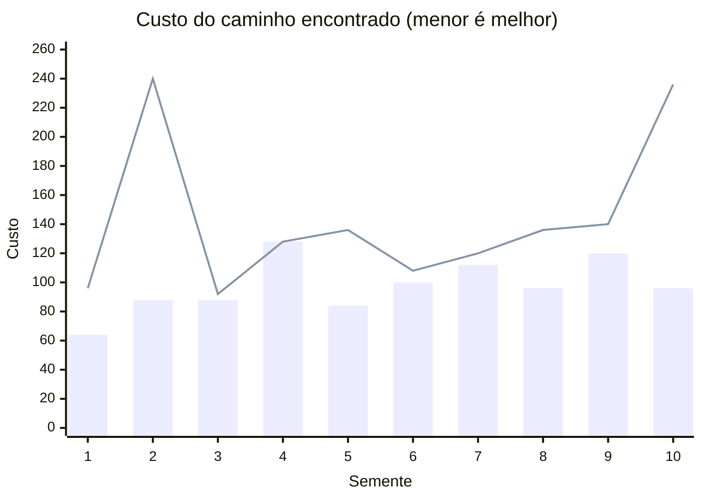
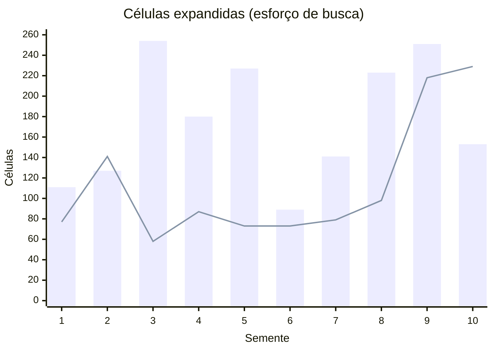

# 06 · Algoritmos: fluxogramas e conceitos

Fluxogramas dos algoritmos implementados (e do previsto para a Sprint 3), escritos para servir
diretamente de **figuras do TCC** (capítulos de Materiais e Métodos e de Resultados). Cada
caixa indica o **evento** que o algoritmo emite para a interface (ver
[02-arquitetura.md](02-arquitetura.md#algoritmos-o-que-cada-um-emite)).

## Mapa conceitual

O que cada algoritmo ensina, para alinhar a plataforma às ementas das disciplinas.

## Geração do labirinto (busca em profundidade randomizada)

A própria geração já é um **backtracking**: avança abrindo passagens e retrocede quando não há
mais salas novas. Esse paralelo pode ser explorado em aula.

## Backtracking

Visão **recursiva**, como é ensinada. A implementação (`algorithms/backtracking.py`) usa uma
pilha explícita equivalente, para não esbarrar no limite de recursão do Python em grades grandes.

## Dijkstra

## Q-Learning

Laço de treinamento implementado em `algorithms/qlearning.py` (detalhes em
[02-arquitetura.md](02-arquitetura.md#q-learning-implementado-na-v03-1111)).

### Q-Learning: escolha dos valores padrão

Os valores padrão foram escolhidos **por experimento** em 11/11/2026, para que o agente aprenda
de forma confiável nos labirintos usados em aula. Cada linha resume 8 labirintos (sementes 1 a
8, aberturas 10%) com α 0,5; ε 0,3; decaimento 0,99 e 200 episódios. "Ótimo" significa que o
caminho aprendido tem o mesmo custo do Dijkstra.

| Grade, lama | γ = 0,95 | γ = 0,99 | **γ = 0,995 (padrão)** | γ = 0,999 |
|---|---|---|---|---|
| 11 × 11, 15% | 5/8 ótimo* | 8/8 | **8/8** | 8/8 |
| 21 × 21, 15% | 0/8 | 8/8 | **8/8** | 8/8 |
| 11 × 11, 40% | — | 8/8 | **8/8** | 8/8 |
| 21 × 21, 40% | — | 5/8 | **7/8** | 7/8 |
| 31 × 31, 15% | — | 1/8 | **1/8** (4/4 com 500 episódios) | 1/8 |

\* Medido na primeira bateria de testes, com ε 0,3 e γ 0,95.

**Por que γ alto?** O episódio só termina ao chegar ao objetivo ou ao atingir o limite de
passos. Com γ baixo, a recompensa do objetivo, descontada ao longo de dezenas de passos,
fica menor que o custo de atravessar o caminho. No labirinto 21 × 21 com 40% de lama e
γ = 0,99, o agente chegou ao objetivo em 100 dos 200 episódios, mas **nos últimos 20 só uma
vez**: passou a preferir ficar rodando em regiões pouco exploradas, cujos valores ainda
pareciam altos. Com γ = 0,995, "rodar sem rumo" fica caro o bastante e o problema some.

Experimentos do roteiro de aula, verificados no labirinto da semente 42: ver
[09-roteiro-aula-qlearning.md](09-roteiro-aula-qlearning.md#3-experimentos-com-os-parâmetros-15-min).

## Comparação com dados reais (Dijkstra × Backtracking)

Experimento reproduzível: grade 21×21, aberturas 10%, lama 15%, sementes 1 a 10 (parâmetros
padrão da plataforma). Dados gerados com o próprio código do projeto em 28/10/2026.

| Semente | Dijkstra: expandidas | Dijkstra: custo | Backtracking: expandidas | Backtracking: custo |
|---:|---:|---:|---:|---:|
| 1 | 111 | 64 | 77 | 96 |
| 2 | 127 | 88 | 141 | 240 |
| 3 | 254 | 88 | 58 | 92 |
| 4 | 180 | 128 | 87 | 128 |
| 5 | 227 | 84 | 73 | 136 |
| 6 | 89 | 100 | 73 | 108 |
| 7 | 141 | 112 | 79 | 120 |
| 8 | 223 | 96 | 98 | 136 |
| 9 | 251 | 120 | 218 | 140 |
| 10 | 153 | 96 | 229 | 236 |
| **Média** | **175,6** | **97,6** | **113,3** | **143,2** |

Nos gráficos abaixo, **barras = Dijkstra** e **linha = Backtracking**. O tipo de gráfico do
Mermaid não exibe legenda, por isso ela está aqui no texto.

**Leitura:**
- O Dijkstra encontra **sempre** o menor custo. O Backtracking empata em 1 de 10 casos
  (semente 4) e chega a custar 2,7× mais (semente 2).
- Em média o Backtracking expande menos células, mas **não sempre**: nas sementes 2 e 10 ele
  explora mais que o Dijkstra e ainda acha um caminho pior. Isso depende da ordem de exploração
  dos vizinhos, que é o item US-13 do backlog.
- Este é o tipo de descoberta que a plataforma permite ao aluno fazer sozinho, e pode alimentar
  o capítulo de Resultados (prompt C07 do catálogo).
