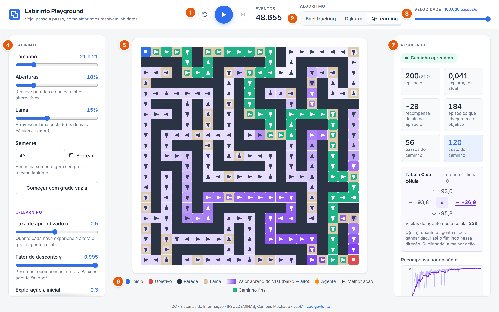
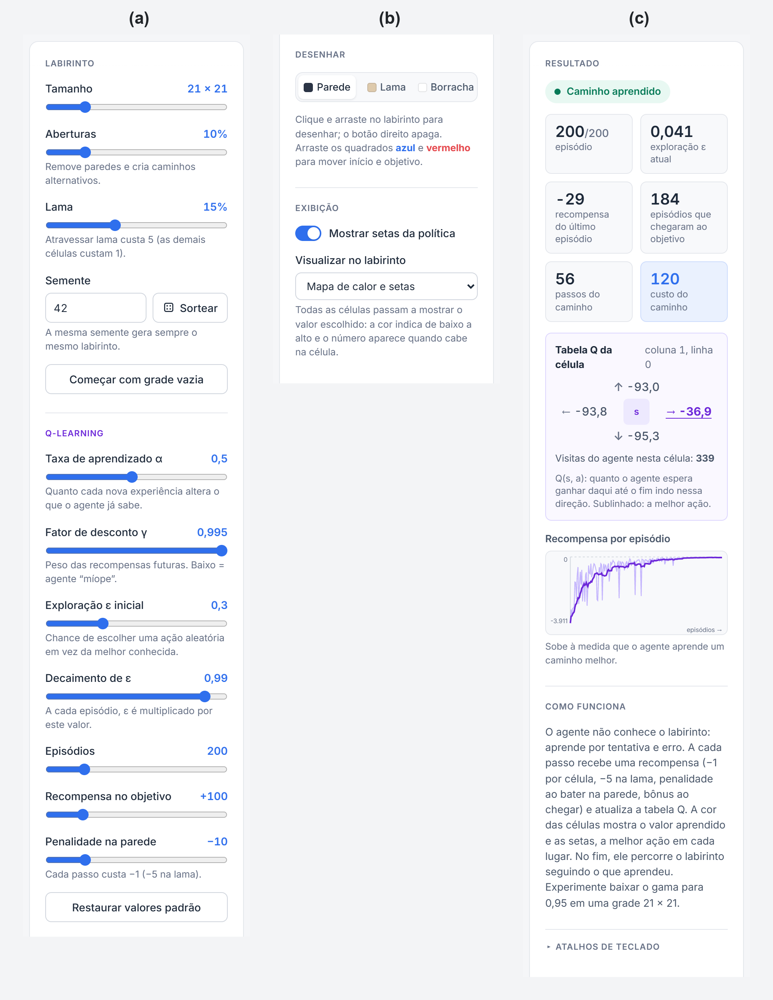

# 11 · Manual de uso (v0.4.1)

Manual da plataforma, organizado por algoritmo. É o mesmo conteúdo do **Apêndice A** do TCC.
A plataforma atende estudantes, que exploram os algoritmos por conta própria, e professores, que
conduzem demonstrações e atividades em sala.

## A.1 Acesso à plataforma

- **Endereço:** <https://raffasrabelo.github.io/labirinto-playground/>, sem instalação nem cadastro.
- **Primeiro acesso:** o navegador baixa o Python compilado para WebAssembly. Isso leva de 10 a
  20 segundos, com uma mensagem de carregamento na tela.
- **Dispositivos:** computador, tablet e celular. A partir de 1181 × 640 px, a interface cabe
  na janela e cada painel lateral rola sozinho, de modo que o labirinto fica sempre visível.

## A.2 Visão geral da interface

| Nº | Área | Função |
|---|---|---|
| 1 | Controles de execução | Reiniciar, executar/pausar e avançar um passo. O contador mostra os eventos executados |
| 2 | Seletor de algoritmo | Backtracking, Dijkstra ou Q-Learning. Trocar reinicia a execução, mas mantém o labirinto |
| 3 | Velocidade | 1 a 100.000 passos/s em escala logarítmica (padrão 20). Pode ser alterada durante a execução |
| 4 | Painel de configuração | Parâmetros do labirinto e do algoritmo, desenho e exibição |
| 5 | Labirinto | Execução do algoritmo; editável com o mouse |
| 6 | Legenda | Cores e símbolos, que mudam conforme o algoritmo |
| 7 | Painel de resultado | Situação, métricas, "Como funciona" e atalhos. No Q-Learning, também o inspetor da tabela Q e o gráfico de recompensa |

## A.3 Execução e atalhos de teclado

| Ação | Botão | Tecla |
|---|---|---|
| Executar / pausar | ▶ | Espaço |
| Avançar um passo (com a execução pausada) | ⏭ | N |
| Reiniciar a execução (mantém o labirinto) | ↺ | R |
| Sortear um novo labirinto | Sortear | G |

- **Situação ao final:** "Caminho encontrado" ou "Não existe caminho" (Backtracking e Dijkstra);
  "Caminho aprendido" ou "O agente não aprendeu o caminho" (Q-Learning).
- **Atalhos desativados:** enquanto o campo da semente ou o seletor de visualização estão
  selecionados.

## A.4 Parâmetros do labirinto (comuns aos três algoritmos)

Alterar qualquer um deles gera um novo labirinto e reinicia a execução.

| Parâmetro | Faixa | Padrão | Efeito |
|---|---|---|---|
| Tamanho | 11 × 11 a 61 × 61 (ímpares) | 21 × 21 | Grades maiores: busca mais longa; no Q-Learning, mais episódios |
| Aberturas | 0% a 50% (passo 5%) | 10% | Probabilidade de remover cada parede interna. Com 0%, há um único caminho entre duas células |
| Lama | 0% a 40% (passo 5%) | 15% | Probabilidade de cada célula livre virar lama (custo 5; as demais custam 1) |
| Semente | 1 a 999 | 42 | Mesma semente + mesmos parâmetros = mesmo labirinto. "Sortear" (G) escolhe outra |
| Começar com grade vazia | — | — | Remove paredes e lama para desenhar do zero |
| Desenhar | Parede, Lama, Borracha | Parede | Clique ou arraste. O botão direito apaga. Arraste o quadrado azul (início) ou o vermelho (objetivo) para movê-los. Toda edição reinicia a execução |

## A.5 Backtracking

Busca em profundidade recursiva: avança para o primeiro vizinho livre não visitado e, num beco
sem saída, retrocede até a última bifurcação com alternativas. Encontra **um** caminho, sem
garantia de menor custo.

- **Parâmetros:** só os do labirinto. Não tem opções de exibição.
- **Legenda:** Expandida, Retrocesso (células abandonadas ao retroceder), Atual, Caminho final.
- **Métricas:** células expandidas; células na pilha e o máximo atingido (profundidade da
  recursão); passos e custo do caminho.
- **Atividade:** com a mesma semente, compare custo e células expandidas com o Dijkstra. Depois,
  aumente as aberturas e veja se a diferença cresce.

## A.6 Dijkstra

Expande sempre a célula de menor custo acumulado, retirada de uma fila de prioridade. Encontra
o caminho de **menor custo**, que nem sempre é o de menos passos.

- **Parâmetros:** só os do labirinto.
- **Mostrar distâncias** (Exibição; padrão ligado): mostra em cada célula expandida a distância
  acumulada desde o início.
- **Legenda:** Na fila, Expandida, Atual, Caminho final.
- **Métricas:** células expandidas; células na fila de prioridade; passos e custo do caminho.
- **Atividade:** compare o mesmo labirinto com 0% e com 40% de lama. Com lama, o caminho de menor
  custo pode ter mais passos.

## A.7 Q-Learning

O agente não conhece o labirinto e aprende por tentativa e erro. As recompensas são:
- −1 ao entrar numa célula livre e −5 na lama;
- a penalidade ao tentar entrar numa parede (o agente fica no lugar);
- a recompensa do objetivo ao chegar.

Ao executar, o agente treina pelos episódios definidos e depois percorre o labirinto seguindo a
política aprendida. Como o treino tem dezenas de milhares de passos, aumente a velocidade.
**Alterar qualquer parâmetro reinicia o treinamento.**

| Parâmetro | Faixa | Padrão | Efeito |
|---|---|---|---|
| Taxa de aprendizado α | 0,05 a 1 (passo 0,05) | 0,5 | Quanto cada experiência altera o valor já aprendido |
| Fator de desconto γ | 0,5 a 0,995 (passo 0,005) | 0,995 | Peso das recompensas futuras. Com γ = 0,95, o agente não aprende o caminho em grades de 21 × 21 |
| Exploração ε inicial | 0 a 1 (passo 0,05) | 0,3 | Probabilidade de escolher uma ação aleatória |
| Decaimento de ε | 0,9 a 1 (passo 0,005) | 0,99 | ε é multiplicado por este valor a cada episódio (mínimo 0,01). Com 1, a exploração fica constante |
| Episódios | 10 a 1.000 (passo 10) | 200 | O episódio termina no objetivo ou no limite de passos (4 × células livres, mínimo 200). Em 31 × 31, use 500 |
| Recompensa no objetivo | 10 a 500 (passo 10) | +100 | Bônus ao chegar |
| Penalidade na parede | 0 a 50 | −10 | Aplicada ao tentar entrar numa parede |
| Restaurar valores padrão | — | — | Volta aos valores acima |

**Exibição:**
- **Mostrar setas da política** (padrão ligado): a melhor ação em cada célula.
- **Visualizar no labirinto:** define o que todas as células mostram:
  - "Mapa de calor e setas" (padrão);
  - V(s), com números;
  - Q(s, a), os quatro valores, com a melhor ação sublinhada;
  - Q(s, ↑), Q(s, →), Q(s, ↓) ou Q(s, ←), o valor de uma ação em todos os estados;
  - Visitas, em escala de cor logarítmica.

  Quando os números não cabem, as cores continuam e a página sugere o inspetor.

**Painel de resultado:**
- **Métricas:** episódio, ε atual, recompensa do último episódio, episódios que chegaram ao
  objetivo e, no fim, passos e custo do caminho aprendido.
- **Inspetor:** passe o mouse sobre uma célula para ver os quatro Q(s, a), com a melhor ação
  sublinhada, e as visitas do agente.
- **Gráfico:** recompensa por episódio, com média móvel.

**Atividades:**
- Compare γ = 0,995 e γ = 0,95 no mesmo labirinto, olhando as setas e o gráfico.
- Em 31 × 31, compare 200 e 500 episódios.
- Reduza o ε inicial a zero e observe o modo "Visitas".
