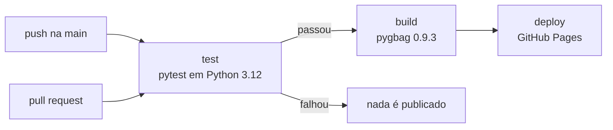

# P02 · Repositório e publicação no GitHub Pages

| Campo | Valor |
|---|---|
| Data | 27/10/2026 |
| Sprint | S0 (adiantado da S1) |
| Item(ns) do backlog | US-06, US-07, T-02 |
| Autor do prompt | Rafael |
| Ferramenta / modelo | Claude Code (Claude Opus 5.5) |

## Prompt enviado

```text
Sim, prepare o repositório e a publicação no GitHub Pages (prompt P02).
Me diga o que eu preciso fazer na minha conta.
```

Remete ao P02 do [catálogo](catalogo.md).

## Resultado obtido
- Repositório Git local criado (branch `main`) com commit inicial da v0.1.
- `.gitignore` deixa de fora os arquivos Word do TCC (o texto continua só no OneDrive) e as
  configurações locais.
- Workflow `.github/workflows/deploy.yml` com três etapas encadeadas:



- Em pull requests só os testes rodam (sem publicar).
- A versão do pygbag é fixa (0.9.3), a mesma validada no P01, para o build não mudar sem aviso.

## Validação local
- YAML do workflow lido sem erros (jobs `test`, `build`, `deploy`).
- Testes executados em ambiente limpo **sem pygame**, como no job `test`: 6/6 ✅.
- Build pygbag do zero: ✅ (`index.html`, `app.apk`, `favicon.png`).
## Publicação (com autorização explícita do autor)
- Repositório público criado: <https://github.com/raffasrabelo/labirinto-playground>
- GitHub Pages ativado com origem **GitHub Actions** (via API, antes do primeiro push).
- Primeira execução do workflow (run 40598328628): `test` ✅ 8s · `build` ✅ 9s · `deploy` ✅ 10s.
- Link público testado: a plataforma carrega, executa e reproduz os resultados do desktop
  (Dijkstra, semente 42, 21×21: custo 120, 56 passos). O erro 404 do pygame-ce visto em
  localhost (P01) não ocorre no Pages, como previsto.
- Avisos não bloqueantes do GitHub: as ações `checkout@v4`, `setup-python@v5`, `upload-pages-artifact@v3`
  e `deploy-pages@v4` usam Node.js 20, que está descontinuado. Atualizar as versões depois (item T-04).

## Revisão da equipe
- Aceito:
- Alterado:
- Rejeitado:

## Evidências
- Commit: `feat: protótipo v0.1 do Labirinto Playground (Sprint 0)`
- Link público: <https://raffasrabelo.github.io/labirinto-playground/>
- Execução: <https://github.com/raffasrabelo/labirinto-playground/actions/runs/40598328628>
