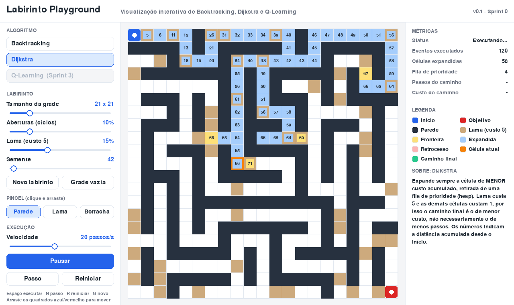

# Sprint 0 · Fundação e protótipo

| Campo | Valor |
|---|---|
| Período | 27/10/2026 – 28/10/2026 (sprint curta de arranque) |
| Sprint Goal | Ter um protótipo navegável que prove a ideia do "playground de algoritmos" e um plano até 30/11 |
| Review | 28/10/2026, com orientador e professora da disciplina |
| Versão / tag | v0.1 · `sprint-0` |

## Sprint Backlog
| ID | Item | Status |
|---|---|---|
| — | Leitura dos documentos e definição da arquitetura | ✅ |
| T-01 | Arquitetura de algoritmos como geradores de eventos + testes (6 testes, todos passando) | ✅ |
| US-01 | Labirinto procedural (DFS randomizado) com semente | ✅ |
| US-02 | Parâmetros: tamanho (11–61), aberturas, lama, semente | ✅ |
| US-03 | Edição com mouse: parede, lama, borracha; arrastar início e objetivo | ✅ |
| US-04 | Executar / pausar / passo / reiniciar / velocidade (1–1000 passos/s) + atalhos | ✅ |
| US-05 | Métricas, legenda e texto explicativo por algoritmo | ✅ |
| US-09 | Distância acumulada nas células (Dijkstra) | ✅ |
| — | Dijkstra e Backtracking funcionando (versão inicial) | ✅ |
| US-06 / US-08 | **Versão web (pygbag)** rodando no navegador + medição de desempenho (adiantado da S1, ver P01) | ✅ |
| US-07 / T-02 | Repositório público + publicação automática no GitHub Pages (P02) | ✅ |
| — | Documentação: visão, requisitos, arquitetura, processo, cronograma, backlog, prompts | ✅ |

## Entregas (incremento v0.1)
- Aplicação desktop em `app/` (`python main.py`).
- **Mesma aplicação rodando no navegador**, sem nenhuma alteração de código:
  **<https://raffasrabelo.github.io/labirinto-playground/>** (publicada automaticamente a cada push).
- Código-fonte: <https://github.com/raffasrabelo/labirinto-playground>
- Documentação em `docs/`.
- Capturas de tela em `docs/img/`.

## Escrita do TCC (pendências encontradas no .docx)
- [ ] Folha de rosto está com **"MACHADO 2021"** (a capa está 2026).
- [ ] Citados no texto, mas **ausentes nas Referências**: Goulart et al. (2019),
      PYTHON SOFTWARE FOUNDATION (2026), PYGAME COMMUNITY (2026).
- [ ] Referências de Rebouças et al. (2010) e Stephan et al. (2020): o campo "Disponível em"
      contém o título da página em vez da URL.
- [ ] O texto cita "Pygame"; tecnicamente usamos **pygame-ce** (fork da comunidade, exigido
      pelo pygbag). Vale uma nota de rodapé na seção 2.3.
- [ ] O título do .docx ("baseado em labirintos") difere do das anotações; padronizar.

## Prompts utilizados
- [P01 · Build web com pygbag](../prompts/P01-build-web.md)
- [P02 · Repositório e publicação no GitHub Pages](../prompts/P02-github-pages.md)

## Sprint Review · roteiro da demonstração (≈ 12 min)

1. **Problema (1 min):** evasão nos 3 primeiros semestres e dificuldade de abstração (Prim e Fávero, 2013; Vieira et al., 2015).
2. **Proposta (1 min):** um "playground" no estilo do TensorFlow Playground: o aluno altera parâmetros e vê o algoritmo reagir.
3. **Demo ao vivo (6 min)**, com grade 21×21 e semente 42:
   1. *Dijkstra* a 10 passos/s: mostrar a fila (amarelo), as células expandidas (azul) e os números de distância crescendo; a lama soma +5.
   2. Terminar: **custo 120, 56 passos, 232 células expandidas.**
   3. Trocar para *Backtracking* com a mesma semente: a pilha cresce, os becos sem saída ficam vermelhos (retrocesso).
      Resultado: **custo 132, 64 passos, só 71 células expandidas.**
      → *"O Backtracking explorou menos, mas achou um caminho pior. O Dijkstra explorou mais para **garantir** o menor custo."*
   4. Desenhar paredes e lama ao vivo, arrastar o objetivo e reexecutar.
   5. Usar **Passo** (tecla N) para mostrar a execução célula a célula.
   6. Mostrar o Q-Learning como "Sprint 3" no seletor.
4. **Como foi construído (2 min):** diagrama de camadas (`docs/02-arquitetura.md`), algoritmos como geradores e testes automatizados.
   Mostrar o **mesmo app no navegador** e citar a medição: 61×61 a 1000 passos/s em cerca de 10 ms por quadro, dentro dos 60 fps.
   → *"O principal risco técnico do projeto, rodar Pygame na web, já foi eliminado."*
   Enviar o link aos stakeholders para que testem durante a semana: o feedback assíncrono também entra na tabela abaixo.
5. **Cronograma (1 min):** `docs/04-cronograma.md` e riscos.
6. **Perguntas (abaixo).**

**Perguntas para os stakeholders:**
1. O escopo de 3 algoritmos está mantido? Se faltar tempo, aceitam um Q-Learning mais simples (só mapa de calor)?
2. A validação com alunos (questionário) é esperada no TCC? Precisa passar pelo Comitê de Ética ou serve uma pesquisa de opinião anônima?
3. Qual a data exata de entrega do texto e da defesa?
4. A linguagem e as cores da interface estão adequadas para um ingressante? O que mais confundiu?
5. As reviews semanais às quartas funcionam? Qual o canal preferido (presencial, e-mail, link)?

### Feedback recebido
| # | Stakeholder | Feedback | Tipo | Decisão / item gerado |
|---|---|---|---|---|
| 1 | | | | |

## Retrospectiva
| Manter | Melhorar | Experimentar |
|---|---|---|
| | | |
